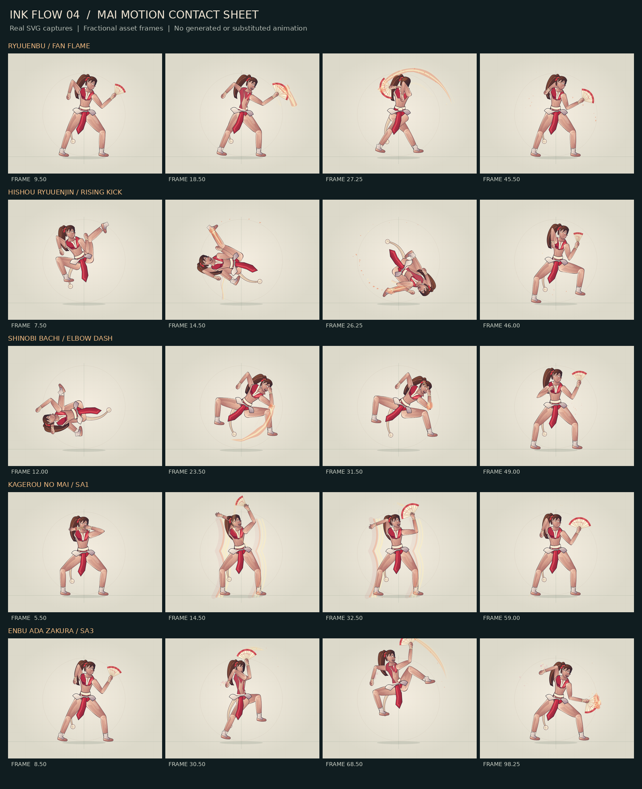

# INK FLOW 04 · 不知火舞「花焰」强化版验证报告

生成时间（UTC）：2026-10-04T10:34:06.725765+00:00。版本：4.0.0。

本报告由 `tools/write_flow4_report.py` 读取已经执行的检查结果生成。它不把汇总当成重新测试；最终浏览器报告、持续运行报告、画面采样及干净源码重建，均对照下方同一份 HTML 的 SHA-256。

## 1. 交付范围与实际改动

基于用户提供的 `INK-Flow-3-Source.zip` 修改，保留八位角色、690 份招式/状态/投技资产与 16 条连段路线。重点更新舞的 44 份资产、动作惯性交接、可行动帧输入缓冲、取消后的世界拖尾、折扇与附件运动、前后景特效和编辑回读。首页增加实际资产演武及舞的实战连段入口。

原始 `game.js` 逐字节未变。新增支持逻辑通过构建接线进入游戏；690 份 `binding`/`boxes` 与 16 条路线定义，使用从原压缩包提取的合同快照逐一比较一致。没有靠增加免费能量、延长受击硬直、扩大判定配置或脚本写伤害来凑连段。

姿势是共享骨骼的输入，所以插值改进可能影响空间采样；规则配置一致，不等于宣称所有边界碰撞逐点完全一致。这里保留并实际运行原有机制及左右连段回归。

## 2. 已执行的自动检查

测试环境为 Linux x86_64、Python 3.13.5、Node 22.16.0、Chromium 144.0.7559.96、Playwright 1.57.0；详细环境记录见 `qa/flow4/environment.json`。这是本轮使用的版本，不是对其他环境的兼容性保证。

| 检查范围 | 通过 / 总数 | 原始结果 |
|---|---:|---|
| 原有核心数学/骨骼 | 44 / 44 | `test-results/ink-core.json` |
| 原有补间与粒子 | 24 / 24 | `qa/flow/core-tests.json` |
| 资产结构与合同 | 720 / 720 | `qa/forge-core.json` |
| 存储合同（显式替身，不是本机权限） | 9 / 9 | `qa/forge-storage.json` |
| 编辑器与导出回读 | 24 / 24 | `qa/forge-browser.json` |
| 连段/动作工坊浏览器流程 | 22 / 22 | `qa/flow/browser-tests.json` |
| 战斗机制 | 39 / 39 | `qa/forge-mechanics.json` |
| 八角色逐招实战回放 | 522 / 522 | `qa/forge-replays.json` |
| 状态与投技 | 164 / 164 | `qa/forge-states.json` |
| 16 条路线 × 左右朝向 | 32 / 32 | `qa/flow/combo-validation.json` |
| 不同渲染调度下连段一致性 | 32 / 32 | `qa/flow/render-invariance.json` |
| 原有双指触摸 | 7 / 7 | `qa/forge-mobile.json` |
| 移动端界面与触摸 | 7 / 7 | `qa/flow/mobile-tests.json` |
| 保留式 SVG 渲染 | 34 / 34 | `qa/forge-retained.json` |
| 入口、说明与交付布局 | 9 / 9 | `qa/flow/delivery-check.json` |
| FLOW 04 新增核心专项 | 55 / 55 | `qa/flow4/core.json` |
| FLOW 04 新增浏览器专项 | 34 / 34 | `qa/flow4/browser.json` |
| 舞的完整路线 G 键矩阵 | 26 / 26 | `qa/flow4/rhythm-matrix.json` |
| 舞扇挂点坐标核对（44×6×2×2） | 1056 / 1056 | `qa/flow4/fan-matrix.json` |

各套件计数有不同含义：逐招回放不是完整连段，合同项不是独立 UI 场景，存储替身不是操作系统授权。不将这些数字相加夸大成同一种测试。浏览器专项中的原生文件协议一项验证“真实尝试及记录结果”，实际导航受环境策略阻止，详见第 6 节。

### 舞的针对性证据

44 份更新资产共进行 5,642 次小数帧有限值采样；完整旋转、交接期限、附件反向采样、零幅值发力节拍均有断言。

折扇不是单张图压缩开合。浏览器直接比较扇柄/扇尖挂点与实际 SVG CTM，7 个姿态、2 个挂点的最大坐标差为 0.005488（本次视口坐标单位）。另外将范围扩展到全部 44 份更新资产、264 个姿态采样、两种输出镜像和两个挂点，在 deviceScaleFactor=2 下完成 1,056 次实际 SVG 坐标核对，最大差为 0.006264；这项镜像输出核对不代替双朝向实战测试。发辫、腰带和绒球在前后拖动后重建一致，装饰变化不写回姿势数据。

常规输入在 24 帧冻结后仍只消费一次；实际命中后的 OD 龙炎舞 → SA3 请求在定格结束后才取消。节奏 G 请求对左右朝向、0F/3F/6F 均检查：冻结中不提前取消，3F/6F 不消耗窗口，0F 不偷偷排队；过早输入与资源不足不会变成自动代打。 另有 26 项 DOM 键盘矩阵检查：舞的两条完整路线、双朝向、三种窗口的合法输入均能完成；提前输入在 3F/6F 中可衔接、在严格 0F 中被拒绝。长按重复 G 不会自动请求后续步骤，焦点位于设置控件时也不触发出招。 矩阵中 4 个“严格 0F + 提前输入”案例以拒绝排队、无法完成连段作为通过条件；原始结果中的 failed 是这类反例的预期表现，不是被忽略的运行错误。

舞的快捷连段实际得到 **14 HIT、3375 伤害**；首次命中后木桩转为防御，用于暴露断连。这个结果来自正常出招和命中结算，不来自演武窗口。原有舞的 11 HIT 与 14 HIT 两条路线，双朝向回归均成立。

世界粒子及轨迹在命中定格最后一帧不反向跳时；取消后的片段保留到寿命结束；关闭视觉效果会实际隐藏局部前/后层、世界粒子和轨迹。清爽模式实际抑制全屏命中闪光。已发出的花瓣在角色根旋转 90° 时保持世界位置和方向。

编辑器先修改姿势、再立即读取特效挂点，确认缓存不再停留在旧姿势；新特效字段保存及导出 HTML 后重新打开仍保留。玩家版也验证了演武与实际 14 HIT 连段，编辑入口隐藏。

## 3. 最终构建持续运行

**通过。** 单个真实 Chromium 页面从 `2026-10-04T10:13:48.886545+00:00` 启动，到 `2026-10-04T10:33:53.108799+00:00` 结束；持续运行测量为 **1201.504 秒（20.03 分钟）**。这是 monotonic 墙钟时间，不是把大量模拟帧换算成分钟。

共完成 **262 次真实连段**，覆盖 9 条路线；主要执行舞的两条路线，同时轮换其他角色、左右朝向、特效质量与低闪动档位。过程还进行 56 次暂停一致性检查、39 次演武/工坊视图切换，累计记录 67,862 次 requestAnimationFrame 回调。路线结果逐次保存在 `qa/flow4/endurance.json`，没有使用失败即重置来掩盖断连。

| 有界资源 | 本次观测最大值 | 配置上限 |
|---|---:|---:|
| 世界粒子 | 320 | 320 |
| 单角色局部粒子 | 67 | 144 |
| 世界拖尾片段 | 19 | 64 |
| 单角色根历史 | 40 | 40 |
| 局部挂点缓存 | 552 | 2048 |

本次未出现未处理浏览器脚本错误、连段失败、越界池容量或非有限 SVG 坐标。首次观测强制 GC 后 JS 堆为 14.61 MiB；后半段检查点范围 16.98–19.08 MiB；结束时 17.48 MiB。切换角色与视图会改变缓存/节点状态，这些数字是本轮观察，不是“永不泄漏”的数学证明。

DOM、JS 堆、暂停次数、视图切换次数与所有检查点都附在原始报告中。最后画面见 `qa/flow4/endurance-final.png`。

## 4. 画面与性能检查

保留式渲染检查中，舞的角色 SVG 为 603 个节点，跨 240 次不同动作采样没有增加节点；重复同姿态没有新的渲染器属性写入。

该次无头环境中，舞的同步 JavaScript 渲染加局部特效耗时中位数 0.80 ms，P95 为 2.00 ms，最大值 3.40 ms。**这不包含浏览器 paint/GPU，也不是实际手机帧率或 120/144 Hz 保证；没有拿它冒充与原版一对一的加速百分比。**

新演武在 390×844、844×390、1280×800、1440×1080 检查无横向溢出；实际触摸事件沿用并运行原有移动端套件。五招二十个小数帧画面另由真实 SVG 截图拼成 `qa/flow4/mai-contact-sheet.png`，人工检查了开扇、旋转、腰带和火焰位置，不是另外生成的概念图。



## 5. 可重建与交付检查

`tools/prove_rebuild.py` 在空临时目录只放入 763 个源文件/资产，不带生成 HTML，再构建创作版与玩家版；两份输出都与交付 HTML 的 SHA-256 一致。

源码包带 `SHA256SUMS.json`，对压缩包使用 `tools/check_source_zip.py` 验证 CRC、路径、逐文件 SHA-256，再在新临时目录构建两份 HTML。该校验是传输完整性与可复现性检查，不是数字签名，也不替代对来源的信任。

```text
创作版 dist/INK-Street-Fighter-6.html
25a726b1fbe3e9f9c13810f09bfdee365004609fc9f7330ec42942311c77ca86

玩家版 dist/INK-Street-Fighter-6-Player.html
ea8360ec6b80a694199091866867c35977f88f197d5ad1ad9f86c3a4ddd2563b

原 game.js
92882d3e0a00549a8cf60e553ed1ecf25b8b51b4584eb1b0a0ffef3f400ce31c
```

源码、两份离线 HTML、文档、测试及原始结果一起交付；没有提交 Git、发布线上站点或写入远程仓库。

## 6. 尚未实测的边界

本环境对实际 `file://` 导航返回 `ERR_BLOCKED_BY_ADMINISTRATOR`。已记录尝试，不能据此宣称实测过双击本地文件。 临时本地 HTTP 服务器的导航也被同一策略阻止，结果另记于 `qa/flow4/origin-protocol.json`。其余浏览器测试加载的是完整独立 HTML 字节；脚本、资产、SVG 与场景均内嵌，无外部网络依赖。

本机目录授权与浏览器持久化权限未做端到端实测；存储事务合同使用明确的测试替身。实际编辑、浏览器导出 JSON/ZIP/HTML、HTML 重新载入已测试。用户浏览器禁止本地存储时应及时导出备份。

移动端是 Chromium 模拟与触摸事件，不是真机长测；没有验证联网对战、回滚同步、官方帧数据、官方动画或三维模型。本项目仍是非官方 2.5D SVG 同人格斗演绎。

## 7. 本地复现

```sh
python tools/check_flow4.py --with-original
python tests/flow4/visual_sheet.py
python tools/prove_rebuild.py
python tests/flow4/endurance.py --seconds 1200
python tools/check_flow.py --report-only
python tools/check_flow4.py --report-only --require-soak
python tools/write_flow4_report.py
python tools/package_flow.py ..
python tools/check_source_zip.py ../INK-Flow-4-Mai-Source.zip
```

构建仅需 Python 标准库；浏览器测试需要 `requirements-dev.txt`、Node 与 Chromium。`--report-only` 不运行新的测试。原始结果在包内 `qa/flow/`、`qa/flow4/` 及报告表中列出的路径。
